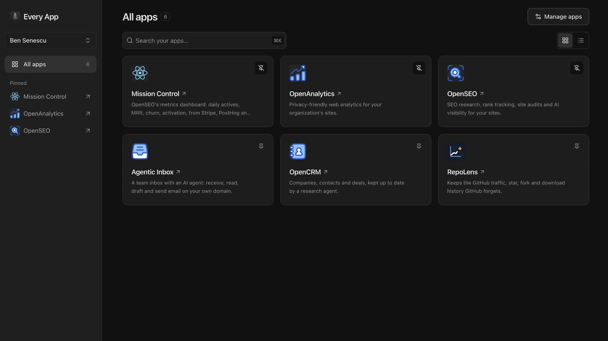

# EveryApp

> Make every SaaS open source

Lots of people are cloning desktop apps, but what about SaaS?

EveryApp is focused on what's after "cloning" by making the next generation of web apps, built for agents.

> Self host open source apps and personal software with one command.

Your agent can build an internal tool in an afternoon, but hosting, database, sign-in, permissions, API keys and backups are still hard. 

EveryApp handles all of that: one command sets up a Gateway in your Cloudflare account, and your team signs in once to use every app.

|                | SaaS                     | EveryApp                              |
| -------------- | ------------------------ | ------------------------------------- |
| You pay        | Per seat, per app        | Your Cloudflare bill, from $5/month   |
| Your data      | On their servers         | In your Cloudflare account            |
| Your agent     | A new connection per app | One MCP server for every app          |
| Need a change? | File a feature request   | Fork it and have your agent change it |

[](https://youtu.be/krDediTp0MI)

## Who are we?

We're the team behind [OpenSEO](https://github.com/every-app/open-seo), the open source alternative to Semrush and Ahrefs (25k stars).


## Apps

- [OpenSEO](https://github.com/every-app/open-seo): Keyword research, rank tracking and site audits.
- [OpenCRM](https://github.com/every-app/open-crm): A simple CRM.
- [OpenScribe](https://github.com/every-app/open-scribe): AI meeting notes for Mac.
- [OpenAnalytics](https://github.com/every-app/open-analytics): Web analytics without cookies.
- [OpenMail](https://github.com/every-app/open-mail): An email inbox with an AI assistant.

## EveryApp Desktop App

Most apps work through the browser, but some work better with a native app. 

One example is [OpenScribe](https://github.com/every-app/open-scribe), our open source alternative to Granola and WisprFlow. 

Download the [Desktop App](https://updates.everyapp.com/mac/download/arm64) for MacOS to use it. 

If you use Windows or Linux, we're looking for people to test it out, it's just an electron app, so it should work for those platforms as well. 

## Get started

> [!NOTE]
> EveryApp is in early development, so expect some rough edges. [For early adopters](https://everyapp.com/docs/early-adopters) says how to get help and tell us what could be smoother. Questions? Ask in [Discord](https://discord.gg/c9uGs3cFXr).

You need a Cloudflare account on Workers Paid ($5/month) and a domain on Cloudflare. Setup takes about 15 minutes.

```bash
npm install -g everyapp
everyapp setup --domain apps.yourcompany.com
```

### Set up Prompt for your Agent.
Paste one prompt into Claude Code, Codex or Cursor: https://everyapp.com/docs/quickstart and let it set everything up.

### Install open source apps
```bash
# Add OpenSEO
everyapp install https://github.com/every-app/open-seo

# Add OpenScribe
everyapp install https://github.com/every-app/open-scribe
```

### Build your own app
https://everyapp.com/docs/create-an-app

```bash
everyapp create my-app
```

## What's on the roadmap?

Oh, nothing much. Just rebuilding every SaaS for agents.

## Usage reports

A self-hosted Gateway sends us a short usage report once a day: a few rounded counts, never names, your domain or anything inside an app. It is how we know how many people use EveryApp. You can read the exact report and turn it off with `everyapp telemetry off`: [what it sends](https://everyapp.com/docs/telemetry).

## Community

⭐ [Star the repo](https://github.com/every-app/every-app) to follow along.

- Docs: [everyapp.com/docs](https://everyapp.com/docs) (for your agent: [everyapp.com/llms.txt](https://everyapp.com/llms.txt))
- Join [Discord](https://discord.gg/c9uGs3cFXr) to chat
- Local development and contributing: [CONTRIBUTING](.github/CONTRIBUTING.md)
- Security holes: report them privately, not in a public issue ([how](docs/security.md#reporting-a-problem)).

## License

MIT, see [LICENSE](LICENSE).
