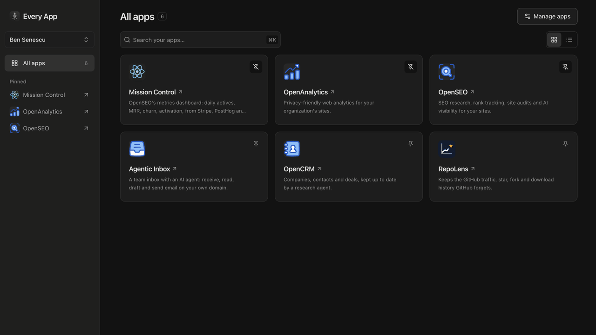

# EveryApp

> Make every SaaS open source

Lots of people are cloning desktop apps, but what's next for SaaS?

EveryApp is focused on making the next generation of web apps, built for agents, beyond "cloning"..

> Get your agent's apps off localhost

Your agent can build an internal tool in an afternoon, but hosting, database, sign-in, permissions, API keys and backups are still hard. 

EveryApp handles all of that: one command sets up a Gateway in your Cloudflare account, and your team signs in once to use every app.

[](https://youtu.be/krDediTp0MI)

## Who are you?

We're the team behind [OpenSEO](https://github.com/every-app/open-seo), the open source alternative to Semrush and Ahrefs (25k stars).

## Why use EveryApp?

**Secure by default**

- Every request passes through the Gateway. Apps have no public address.
- Connect an API once. Apps ask for access, and the Gateway makes the call, so no app ever holds your keys.
- Don't trust us? Good. Put it all behind [Cloudflare Access](https://everyapp.com/docs/access).

**Scales from zero to infinity**

- Fully serverless, in your own Cloudflare account.
- An app nobody uses costs $0.
- $5/month for Cloudflare's Workers Paid plan hosts hundreds of apps.

**Standardized**

- When you add an app, it’s immediately accessible through the Every App MCP Gateway.
- No infra decisions. Every app runs on Cloudflare's building blocks: Workers, D1, R2 and KV.
- Your agent builds with our stack and component library, so it never has to invent patterns.

## Apps

- [OpenSEO](https://github.com/every-app/open-seo): SEO research you pay for by use, not by the month.
- [OpenCRM](https://github.com/every-app/open-crm): A CRM that fills itself in.
- [OpenAnalytics](https://github.com/every-app/open-analytics): Web analytics on your own Cloudflare account. No cookies.
- [OpenMail](https://github.com/every-app/open-mail): An inbox where an AI agent drafts your replies and you hit send.

Run one as it is, or fork it as the starting point for your own. Many more are coming.

## Get started

> [!NOTE]
> EveryApp is in early development, so expect some rough edges. [For early adopters](https://everyapp.com/docs/early-adopters) says how to get help and tell us what could be smoother. Questions? Ask in [Discord](https://discord.gg/c9uGs3cFXr).

You need a Cloudflare account on Workers Paid ($5/month) and a domain on Cloudflare. Setup takes about 15 minutes.

```bash
npm install -g everyapp
everyapp setup --domain apps.yourcompany.com
```

Or [paste one prompt into Claude Code, Codex or Cursor](https://everyapp.com/docs/gateway#or-let-your-coding-agent-do-it) and let it set everything up.

Then install an app with `everyapp install https://github.com/every-app/open-seo`, or [build your own](https://everyapp.com/docs/create-an-app) with `everyapp create my-app`.

## What's on the roadmap?

Oh, nothing much. Just rebuilding every SaaS for agents.

## Community

⭐ [Star the repo](https://github.com/every-app/every-app) to follow along.

- Docs: [everyapp.com/docs](https://everyapp.com/docs) (for your agent: [everyapp.com/llms.txt](https://everyapp.com/llms.txt))
- Join [Discord](https://discord.gg/c9uGs3cFXr) to chat
- Local development and contributing: [CONTRIBUTING](.github/CONTRIBUTING.md)
- Security holes: report them privately, not in a public issue ([how](docs/threat-model.md#reporting-a-problem)).

## License

MIT, see [LICENSE](LICENSE).
