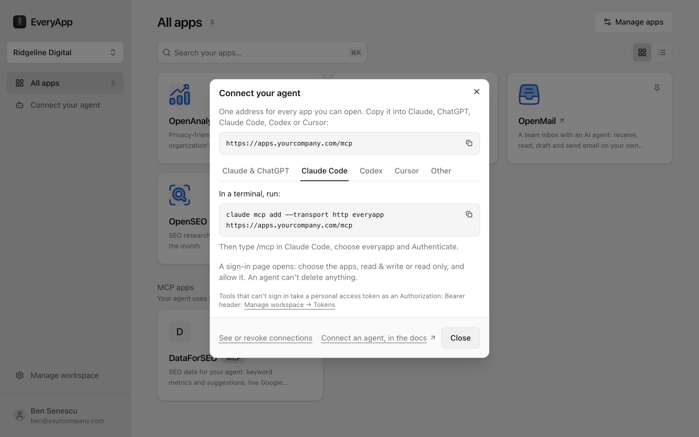
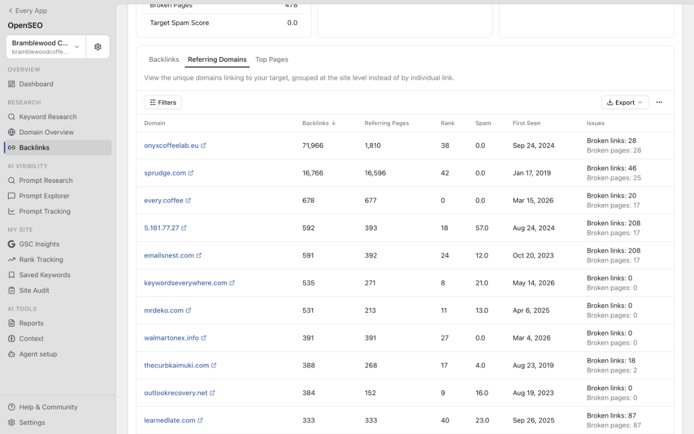
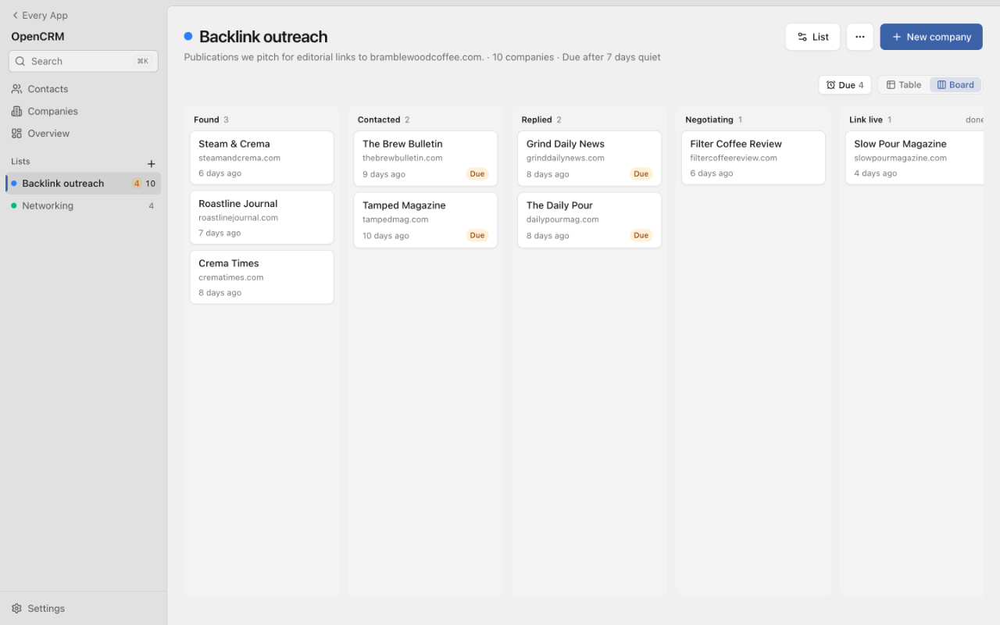
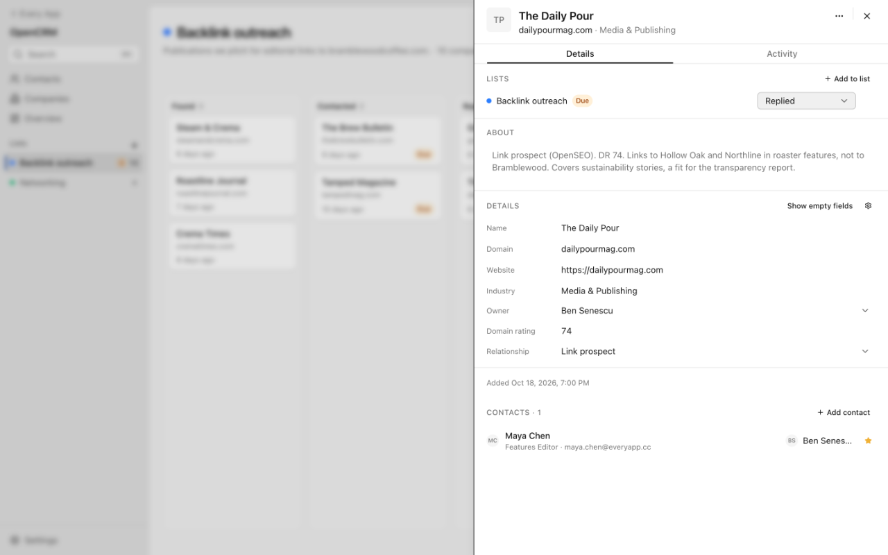
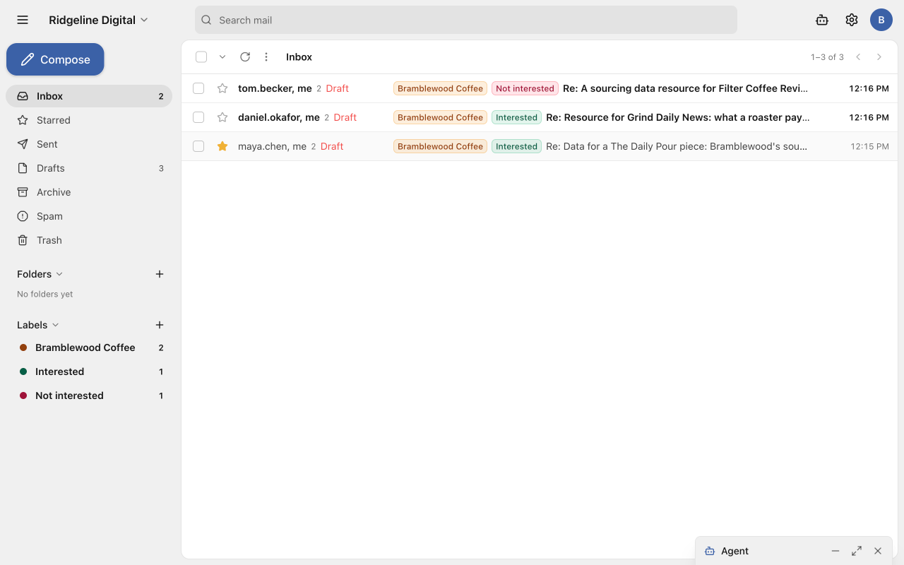
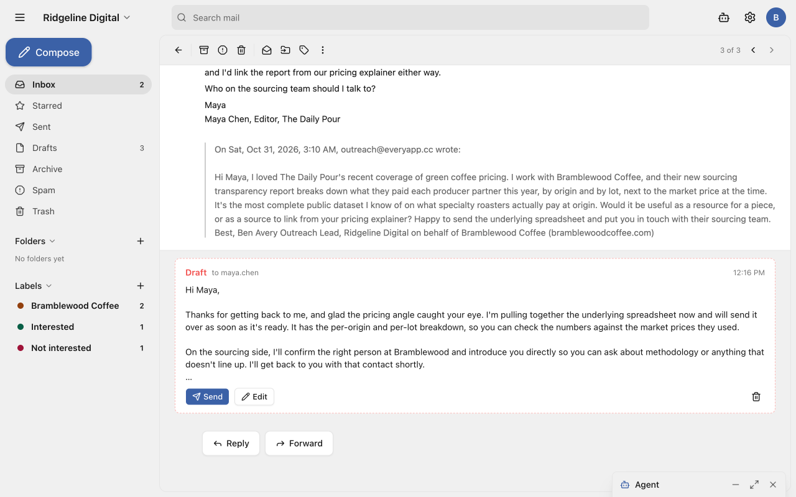

Backlink outreach is the same loop every time. Find sites that might link to you, find the right person at each one, pitch them, keep track of who replied, and follow up with the ones who didn't. Usually that's a backlink tool, a spreadsheet and an inbox, with you copying between them.

This post builds that loop from three open source apps on your own Cloudflare account: OpenSEO for the research, OpenCRM to track each prospect, and OpenMail to send the pitches. Claude Code connects to all three at once, so it does the work across them. You decide who to pitch and what gets sent.

Our example client is Bramblewood Coffee, a roaster that wants links from coffee publications.

## 1. Set it up

You need a Cloudflare account on Workers Paid ($5/month) and a domain on Cloudflare. Then copy this into Claude Code, Codex or Cursor:

```text
Set up EveryApp for me, then install OpenSEO, OpenCRM and OpenMail.
Docs: https://everyapp.com/llms.txt (read index.md and setup.md there).
```

Your agent installs the CLI, sets up your Gateway on your Cloudflare account, installs the three apps, and lets OpenMail send and receive mail on your domain. It stops when it needs you: approving the Cloudflare login, creating your owner account, pasting an API key. It takes about 15 minutes.

If you'd rather run it yourself, the commands are on the [quick start](/docs/quickstart).

## 2. Connect Claude Code

Every app on the Gateway is behind one MCP address. Open **Your connections** in the Gateway's sidebar and pick **Claude Code**:



Run the command it shows, with your Gateway's address:

```bash
claude mcp add --transport http everyapp https://apps.yourcompany.com/mcp
```

Type `/mcp` in Claude Code, choose **everyapp** and **Authenticate**. A sign-in page lets you pick the apps and read only or read & write. Tools that delete are marked, so Claude Code can ask you first.

## 3. Find prospects in OpenSEO

The best link prospects are sites that already link to your competitors. They write about your topic, and they've linked to someone like you before.

OpenSEO shows you those sites. Enter a competitor's domain under **Backlinks** and open **Referring Domains**: one row per site that links to them, with how many links each has and a spam score.



You could go through that list by hand for each competitor. Instead, ask Claude Code for the whole job:

```text
Find sites that link to two of bramblewoodcoffee.com's competitors but not to
Bramblewood. Pick the 10 best coffee publications, find the right person to
pitch at each one, and add them to the Backlink outreach list in OpenCRM at Found.
```

Claude Code pulls each competitor's referring domains from OpenSEO, keeps the sites that link to both, drops the spam, and looks up an editor at each one. Then it adds each publication and its editor to OpenCRM. Nothing gets copied between tabs.

The lookups run on your own DataForSEO account, so a client's research costs what those requests cost.

## 4. Track them on a list in OpenCRM

In OpenCRM, an outreach campaign is a list with stages. Ours is **Backlink outreach**, with Found, Contacted, Replied, Negotiating, Link live and Not interested. The board shows where every pitch stands:



Each publication's record has its stage, why it's on the list, and the person to pitch. Every change lands on its timeline, so anyone on the team can pick up where you left off.



The list also has a follow-up rule. Ours marks a publication **Due** after 7 quiet days, so nobody falls through the cracks. Claude Code reads the list too, so you can ask it instead of checking the board:

```text
Who on the Backlink outreach list is Due, and where did we leave each one?
```

## 5. Pitch them from OpenMail

OpenMail is an email inbox on your own domain. outreach@yourdomain.com is one mailbox that your team shares, and Claude Code can read it and write drafts in it. Ask it:

```text
Write a short pitch to each editor on the Backlink outreach list at Found,
from outreach@yourdomain.com. Use why each site is on the list. Save them as drafts.
```

It writes one pitch per editor, using what it found in step 3, and saves each one in OpenMail's Drafts. Read them there and change any you want. Then send them, or tell Claude Code "Send those and move them to Contacted." Claude Code only sends when you tell it to.

## 6. Handle replies and follow-ups

Replies land in the outreach inbox, threaded under your pitch:



Ask Claude Code to keep the list up to date:

```text
Check outreach@ for replies to our pitches. Move each publication that replied
to Replied on the Backlink outreach list, and tell me what each one asked for.
```

OpenMail's own agent has already drafted an answer to each reply. Open one, read the draft under the message, then click **Edit** to change it or **Send** to send it.



For the publications that went quiet, ask Claude Code: "Draft a short follow-up to everyone on the list who's Due." The follow-ups go to Drafts, like the pitches.

That's the whole loop. Run step 3 again for the next client, or the next batch of prospects, and the rest works the same way.

## 7. Check what your agent did and what it cost

Claude Code did a lot of this on its own, so you'll want to see it. **Manage workspace → Activity** lists every tool call it made. **Usage** shows what each app cost this month, including the DataForSEO lookups.

To keep research from running up a bill, cap it. Ask Claude Code, as an owner or admin:

```text
Cap OpenSEO at $20 a month.
```

OpenSEO pauses once it reaches the cap.

EveryApp is early, so expect some rough edges. If something is harder than it should be, tell us in [Discord](https://discord.gg/c9uGs3cFXr).

## Give us a Star ⭐

We just launched publicly. We'd appreciate any support or feedback 🙏: https://github.com/every-app/every-app
