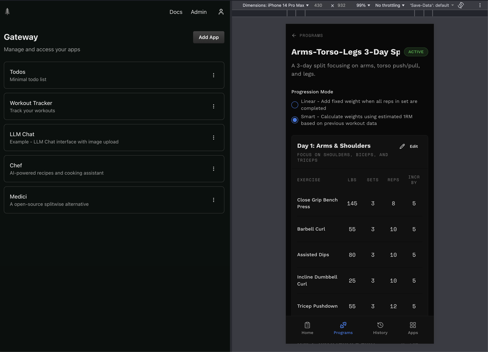

Every App is a platform for self-hosting apps. You can install popular open-source apps or build your own.

Everything runs in your own Cloudflare account, on the Workers Paid plan: $5 a month, plus usage above generous included amounts ([what it costs](/docs/how-it-works/gateway#what-it-costs)).

You don't need to be an engineer. `npx everyapp setup` sets everything up in one command, and the [Quickstart](/docs/getting-started/quickstart) gives you a prompt to paste into your coding agent, which runs it for you.

## The Gateway

The Gateway is where you access all your apps. It sits in front of them, so they are secure by default.

_The Gateway (left) showing your self-hosted apps, and a Workout Tracker app on mobile._

You sign in to the Gateway once. Each app gets its own web address, such as `todo.apps.your-domain.dev`, but you use the same account for all of them. The Gateway checks who you are before letting you into an app. Your apps never see your password or need their own login system.

Apps only accept requests that come through the Gateway. If an app is missing an auth check, the Gateway still keeps it from being exposed directly to the internet.

### What the Gateway gives you

- Open all your apps from one place, on desktop or mobile.
- Sign in once instead of setting up login for every app.
- Invite teammates and choose which apps they can use.

## Where to go next

1. [Quickstart](/docs/getting-started/quickstart) to set up your Gateway with one command.
1. [What the Gateway does](/docs/how-it-works/gateway): its promises, costs and limits on one page.
1. [Build an App](/docs/build-an-app/create-app) to create your first app with a coding agent.
1. [How It Works](/docs/how-it-works/overview) to learn about the architecture.
